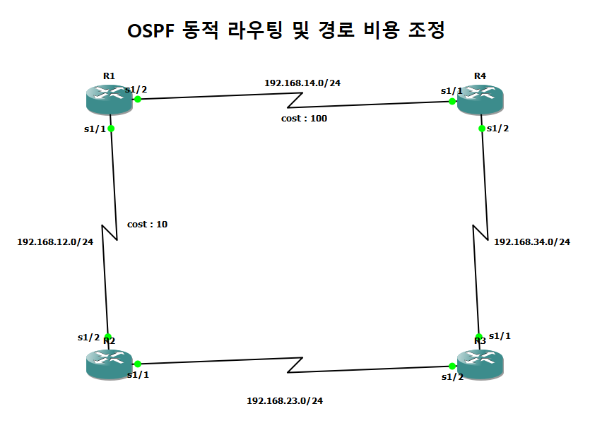

# TopoLog

**GNS3 실습 증거 수집·기록 도구 · v0.1.0 프로토타입**

GNS3 실습의 토폴로지, 장비 설정, 실제 검증 출력을 수집해 종합 자료로 정리하는 도구입니다. 원하는 최종 문서는 내보낸 자료와 프롬프트를 개인 AI 계정에 전달해 편집합니다.

직접 GNS3 네트워크를 구성한 뒤 화면을 찍고 명령 결과를 문서로 옮기는 작업이 반복되어 만들기 시작했습니다. 자료 수집에 드는 시간을 줄이고, 나중에 다시 확인할 수 있는 근거를 남기는 것이 목표입니다.

현재는 Windows에서 수집 경로를 검증하는 프로토타입입니다. 최종 앱의 실행 방식은 확정하지 않았습니다.

## v0.1.0 업데이트 상세 — 2026-11-03

첫 공개 버전에서는 토폴로지 캡처, 실제 명령 출력 수집, 보고서 생성을 하나의 실행 흐름으로 연결했습니다.

| 항목 | 추가·변경 내용 |
| --- | --- |
| 토폴로지 이미지 | GNS3 자체 Take a screenshot 기능으로 전체 장면을 저장합니다. 일반 창 캡처에서 자체 내보내기로 전환해 메뉴·도구 패널 없이 아이콘·연결·주석을 보존합니다. |
| 저장 자동화 | 최소화된 GNS3 창 복원, 저장 대화상자의 파일명 입력·저장을 자동화했습니다. 이전에 열린 GNS3 Screenshot 저장 창에서도 이어서 처리합니다. |
| 실제 명령 출력 | R1에서 `show ip interface brief`, `show ip ospf neighbor`, `show ip route`를 수집합니다. 읽기용 텍스트, 원본 디코딩 로그, Telnet 수신 바이트와 수집 시각을 보존합니다. |
| 현재 프로젝트 조회 | 개발 참고 ZIP을 읽던 방식을 GNS3 API의 프로젝트·장비·연결·주석 조회로 바꿨습니다. 배포본은 `origin/` 없이 실행합니다. |
| 종합 자료 내보내기 | HTML 미리보기, Markdown 보고서, 토폴로지·출력 이미지, 수집 로그, 설정 수집 상태, 파일 출처·해시와 AI 편집 프롬프트를 ZIP으로 묶습니다. |
| 웹 데모 | 기존 수집 결과를 보는 화면에 탭 전환, 명령 선택, 이미지·텍스트 전환, 원문·프롬프트 다운로드를 추가했습니다. 데스크톱과 모바일 폭을 지원합니다. |
| 보고서 표시·검사 수정 | 설정 수집 개수가 한글 문장 안에서 빠지는 표시 오류를 수정했습니다. 설정이 없어 `configs/`가 비어 있는 ZIP도 파일 검증을 수행하도록 검사 코드를 수정했습니다. |

**실제 확인:** Windows·GNS3 2.2.61에서 참고 자료가 없는 독립 배포본으로 API 조회, 자체 스크린샷, R1 명령 3개 수집, 보고서·ZIP 생성까지 확인했습니다. 생성 파일 22개의 해시와 ZIP CRC·문서 연결을 검사했습니다.

**남아 있는 제한:** 해당 실행에서 R1~R4의 startup 설정 4개는 API에 파일 경로가 없어 모두 미수집으로 기록됐습니다. 실제 설정 파일 수집 성공은 확인하지 않았습니다. Ping·traceroute·장애 전환과 다른 프로젝트·장비 적용도 추가 확인 범위입니다. 현재 버전은 Pre-release입니다.

전체 변경 이력은 [CHANGELOG.md](CHANGELOG.md), 배포 설명은 [RELEASE_NOTES.md](RELEASE_NOTES.md), 검사 근거는 [VALIDATION.md](VALIDATION.md)에 기록합니다.

## 빠른 실행

1. GNS3에서 `20260827-1` 프로젝트와 R1~R4를 실행합니다. 최소화된 창은 도구가 자동으로 복원합니다. 토폴로지 이미지는 GNS3 자체 기능으로 전체 장면을 내보내므로 현재 화면에 맞춰 축소할 필요가 없습니다.
2. 이 폴더의 `TopoLog.cmd`를 실행합니다. 서버 조회 → 현재 프로젝트 정보·저장 설정 수집 → GNS3 자체 토폴로지 스크린샷 저장 → R1의 show 출력 수집 → 보고서·ZIP 생성을 순서대로 진행합니다. 실행 중에는 GNS3 저장 대화상자와 R1 콘솔에 다른 입력을 하지 않습니다.
3. 자동으로 열린 보고서에서 캡처와 출력을 확인합니다. ZIP은 자료 기준 폴더의 `exports/`, 실행 기록은 `work/run_날짜시간/`에 저장됩니다.

이 실행은 장비를 자동으로 시작하거나 설정을 변경하지 않습니다. GNS3 창과 장비가 실행 중인 환경을 대상으로 합니다.

## GNS3 자체 토폴로지 스크린샷

프로젝트명이 일치하는 GNS3 창을 찾고, 자체 Take a screenshot 기능을 실행합니다. 저장 대화상자의 파일명에 새 PNG 경로를 넣고 저장까지 자동 진행합니다. GNS3가 그리는 토폴로지 장면 전체를 사용하므로 메뉴·도구 패널이 이미지에 포함되지 않습니다.

최소화되어 있으면 먼저 자동 복원을 요청합니다. 자체 기능이나 저장 대화상자를 확인하지 못하면 실패로 기록하고 중단합니다. 전체 창 캡처로 자동 대체하지 않습니다. 생성 시각·창 제목·방법·파일 해시·내보내기 단계를 보존합니다.

GNS3 소유의 Screenshot 저장 창이 이미 열려 있으면 해당 창에서 이어서 저장합니다. 표준 Windows 저장 창은 언어에 의존하지 않는 컨트롤 ID로 파일명 입력과 저장을 진행하며, 다른 앱의 저장 창은 처리하지 않습니다.

이미지 파일 생성과 실제 토폴로지가 올바르게 보이는지는 구분합니다. 첫 자체 스크린샷은 내용을 확인한 뒤 검증 완료로 기록합니다. 이전의 PrintWindow·Screen 방식은 진단용 창 캡처이며 기본 실행에서 사용하지 않습니다.

## 현재 지원 범위

- GNS3 2.2 서버 설정 주소와 저장된 인증을 로컬에서 사용합니다. 비밀번호를 결과 파일에 기록하지 않습니다.
- 실행 중인 Dynamips/Telnet 장비에서 고정된 show 명령 3개를 수집합니다.
- GNS3 API로 현재 프로젝트의 장비·연결·주석과 읽을 수 있는 Dynamips startup 파일을 수집합니다. startup 파일과 실제 실행 출력을 구분하고 원본 로그·수신 바이트를 보존합니다.
- GNS3 자체 토폴로지 스크린샷 또는 기존 이미지의 출처를 기록하고, 저장 파일 재구성 그림을 보조 자료로 제공합니다.
- 오프라인 HTML 미리보기, Markdown, 이미지, 설정, 로그, 출처·해시 목록, AI 프롬프트를 ZIP으로 제공합니다.

개발 참고 자료인 `origin/`은 실행에 필요하지 않습니다. 읽지 못한 설정은 미수집으로 기록하며 과거 참고 자료로 대신 채우지 않습니다. API 조회는 순차적으로 수행하므로 조회 시점 차이가 있을 수 있습니다. running-config 수집, VPCS, 자동 기동, 다중 장비 일괄 수집, 사용자 판정 편집과 재검증 이력 화면은 후속 구현 대상입니다.

## 개발 검증 상태

기존 프로토타입은 사용자 Windows 환경에서 GNS3 자체 Screenshot 저장, R1의 show 명령 3개 수집, HTML·Markdown·ZIP 생성을 확인했습니다. 생성된 835×599 토폴로지 이미지에서 메뉴·패널 없이 R1~R4와 연결 전체가 보이는지 검토했고, ZIP CRC·파일 해시·문서 연결 검사도 통과했습니다.

이후 참고 자료 의존성을 제거했습니다. 2026-11-03 16:24(KST)에 `origin/`과 로컬 출력 설정이 없는 독립 배포본에서 실제 GNS3 API 조회 → 자체 스크린샷 → R1 명령 수집 → 보고서·ZIP 생성을 확인했습니다. 생성 파일 22개의 해시와 ZIP CRC·문서 연결을 검사했습니다. 이 실행에서 API는 startup 파일 경로를 제공하지 않아 R1~R4 설정 4개는 미수집으로 남았습니다. 설정 수집까지 성공한 것은 아닙니다.

확인된 실습은 `20260827-1` 하나이고 실제 출력 수집 대상은 R1입니다. 다른 실습·장비, 네트워크 통신의 최종 성공 판정, 장비 자동 기동은 별도로 검증해야 합니다.

이 오프라인 HTML 문서는 수집 결과 미리보기이며 외부에서 접근할 수 있는 서비스 주소가 아닙니다.

## 읽기 전용 데모

`docs/index.html`을 브라우저로 열면 실제로 수집한 토폴로지와 R1 출력을 확인할 수 있습니다. 탭 전환, 명령 선택, 텍스트·이미지 전환, 원문·프롬프트 다운로드를 지원합니다. 새 수집은 Windows 실행 도구에서 진행합니다.

데모에는 원본 장비 설정이나 서버 인증 정보를 포함하지 않았습니다. 새 수집에는 사용자의 실행 중인 GNS3 프로젝트가 필요하며 개발 당시의 분석 ZIP은 필요하지 않습니다.

GitHub Pages에서는 저장소의 `main` 브랜치와 `/docs` 폴더를 게시 원본으로 선택할 수 있습니다. 버전 설명은 [RELEASE_NOTES.md](RELEASE_NOTES.md), 변경 이력은 [CHANGELOG.md](CHANGELOG.md)에 정리했습니다.

## 개발 검사

현재 프로젝트 수집과 참고 자료 없는 내보내기는 `tests/test-project.ps1`, 출력 경로는 `tests/test-paths.ps1`로 검사합니다. 캡처 로직 검사는 `tests/test-capture.ps1`, 생성한 ZIP·파일 해시·문서 연결 검사는 `tests/test-export.py`를 사용합니다. 브라우저 검사는 Node.js와 Playwright가 설치된 환경에서 `tests/test-demo.cjs`로 실행할 수 있습니다. Playwright를 별도 위치에서 사용할 때는 `TOPOLOG_PLAYWRIGHT_MODULE`에 해당 모듈 경로를 지정합니다. 앱 실행에는 Node.js나 Playwright가 필요하지 않습니다.

## 폴더 구성

소스 ZIP을 풀면 `TopoLog/`에 실행 파일 `TopoLog.cmd`, 수집 도구 `tools/`, 테스트 `tests/`, 웹 데모 `docs/`와 공개 문서가 있습니다.

소스만 별도로 내려받으면 `TopoLog.cmd`와 같은 위치에 `work/`, `exports/`, `release/`를 생성합니다. `origin/`은 만들 필요가 없습니다. 선택적인 로컬 설정 `.topolog-workspace.json`의 `data_directory`로 출력 위치를 바꿀 수 있으며 이 설정은 배포 ZIP에서 제외합니다.

## 주요 파일

| 경로 | 역할 |
| --- | --- |
| TopoLog.cmd | 기본 실습의 통합 실행 |
| tools/run-demo.ps1 | 서버 조회·화면 캡처·콘솔 수집·내보내기 연결 |
| tools/capture-gns3.ps1 | 토폴로지 스크린샷 방식 선택 및 출처 기록 |
| tools/export-gns3-screenshot.ps1 | GNS3 자체 Screenshot 실행과 PNG 저장 자동화 |
| tools/collect-console.ps1 | 실제 명령 출력 수집 |
| tools/collect-project.ps1 | 현재 프로젝트 API 스냅샷·저장 startup 파일 수집 |
| tools/export-evidence.ps1 | 종합 자료와 오프라인 보고서 생성 |
| work/ (자료 기준 폴더) | 실행별 진단·수집 기록 |
| exports/ (자료 기준 폴더) | 생성한 보고서 폴더와 ZIP |
